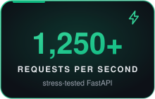
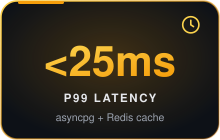
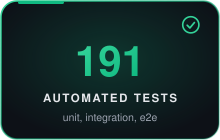
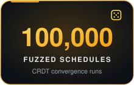
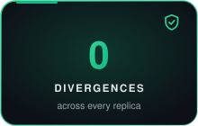

  

  

 

 

<table>
<tr>
<td width="190" align="center"></td>
<td><b>B.E. Information Science & Engineering</b> Sambhram Institute of Technology · graduated May 2026</td>
</tr>
<tr>
<td align="center"></td>
<td><b>AI Engineer</b> · <b>Backend Systems Engineer</b> · <b>GenAI / Agentic Systems Architect</b> · <b>Full-Stack Engineer</b></td>
</tr>
<tr>
<td align="center"></td>
<td><b>AI & Full-Stack Developer Intern</b> at NanoStream Technologies production POS systems and cloud deployment</td>
</tr>
<tr>
<td align="center"></td>
<td><b>Immediate joiner</b> (0 days notice) · Bengaluru, India · open to <b>remote</b> and <b>relocation</b></td>
</tr>
</table>

 

 

<table>
<tr>
<td width="50%" valign="top">

> Compound AI systems on **LangGraph**: hierarchical supervisor routing, deterministic **human-in-the-loop** gates and adversarial Text-to-SQL reflection loops.

> Async FastAPI services stress-tested at **1,250+ req/sec** with sub-25 ms P99, using `asyncpg` pooling and Redis caching.

</td>
<td width="50%" valign="top">

> I benchmark my own code against the alternatives and publish the results, including where I lose.

> I write the core myself when durability and determinism matter, instead of hiding it behind a library.

> Property-based fuzzing, browser end-to-end, load and chaos tests.

</td>
</tr>
</table>

 

 

<table>
<tr>
<td width="50%" valign="top">

### 🤖 [EnterpriseIQ Multi-Agent Swarm](https://github.com/Nikil-R/Autonomous-Multi-Agent-Enterprise-Data-and-Workflow-Swarm)
Hierarchical LangGraph routing with an adversarial evaluator-optimizer loop for Text-to-SQL, and human-in-the-loop safety gates backed by persistent checkpointers.

</td>
<td width="50%" valign="top">

### ⚡ Distributed Microservices Backend
Benchmarked at **1,250+ RPS with under 25 ms P99**. Async PostgreSQL pooling (`asyncpg`), non-blocking Redis caching and Pydantic v2 serialisation.

</td>
</tr>
<tr>
<td width="50%" valign="top">

### 🔄 [Real-Time Collaborative Editor using CRDTs](https://github.com/Nikil-R/Real-Time-Collaborative-Editor-using-CRDTs)
A multi-file code workspace on a **hand-written RGA CRDT**: live cursors, offline editing, automatic merge. Fuzz-tested over 100,000 schedules with 0 divergences, with load and chaos tests, and benchmarked against Yjs.

</td>
<td width="50%" valign="top">

### 🍽️ [Enterprise Restaurant POS](https://github.com/Nikil-R/Restaurant-Software)
Built during the NanoStream internship. Multi-tenant Admin and SuperAdmin dashboards, live order streaming, inventory tracking and role-based access, deployed on AWS EC2.

</td>
</tr>
</table>

 

 

<table>
<tr>
<td align="right"></td>
<td></td>
</tr>
<tr>
<td align="right"></td>
<td>
  
  
  
  
  
</td>
</tr>
<tr>
<td align="right"></td>
<td></td>
</tr>
<tr>
<td align="right"></td>
<td></td>
</tr>
<tr>
<td align="right"></td>
<td></td>
</tr>
<tr>
<td align="right"></td>
<td>
  
  
  
  
</td>
</tr>
</table>

 

 

  

 

